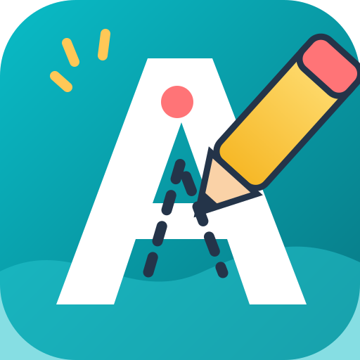

<div align="center">



# SLOVIGO
### Učimo pisati kroz igru

**Vesela Android učionica u kojoj svako slovo postaje mala pustolovina.**

[](https://developer.android.com/)
[](https://developer.android.com/jetpack/compose)
[](#privatnost-i-sigurnost)
[](https://github.com/bren-wp/Slovigo/releases)
[](https://github.com/bren-wp/Slovigo/actions/workflows/android.yml)

**[Preuzmi testnu verziju](https://github.com/bren-wp/Slovigo/releases)** · **[Pregledaj izvorni kod](https://github.com/bren-wp/Slovigo)** · **[Privatnost](PRIVACY.md)**

</div>

---

## ✨ Učenje koje izgleda kao igra

**SLOVIGO** je hrvatska nativna Android aplikacija za vježbanje pravilnog pisanja velikih i malih tiskanih slova. Dijete prati označene poteze prstom, uči redoslijed crtanja i vidi vlastiti napredak — bez oglasa i bez korisničkog računa.

| 🔤 Hrvatska abeceda | ✍️ Pisanje prstom | ⭐ Pohvale i napredak |
|:--:|:--:|:--:|
| Svih 30 slova, uključujući Č, Ć, Đ, Š, Ž, DŽ, LJ i NJ | Smjerovi i početne točke poteza | Lokalno praćenje naučenih slova |

## 📱 Stvarni prikazi i kvaliteta

Splash (01), Početna (02), Velika tiskana slova (03), Mala tiskana slova (04), Vježbanje pisanja (05), Pohvala (06), Moj napredak (07), Igre (08) i Postavke (09) imaju zasebne responzivne Compose implementacije za mobitele i tablete. **Podudarnost 1:1 još nije izmjerena ni potvrđena usporedbom sa stvarnim prikazom.**

Prethodne PNG snimke emulatora bile su **nevaljane** jer su prikazivale Androidov ANR (`Process system isn't responding`) umjesto SLOVIGO aplikacije. Iz marketinške prezentacije uklonjene su njihove poveznice. Valjane snimke mogu se objaviti tek kada prođu stvarnu UI provjeru; stari PNG-ovi u repozitoriju nisu dokaz uspješnog prikaza.

[Pokreni opcionalnu provjeru emulatora](https://github.com/bren-wp/Slovigo/actions/workflows/screenshots.yml) · [Android CI](https://github.com/bren-wp/Slovigo/actions/workflows/android.yml)

## 🎨 Vizualni identitet

| Boja | HEX | Namjena |
|:--|:--|:--|
| 🟦 Tirkizna | `#168D99` | Primarne akcije i napredak |
| 🟨 Žuta | `#FFC857` | Aktivni potezi, poticaji |
| 🟥 Koraljna | `#FF7477` | Istaknuti detalji i maskota |
| 🟪 Plava | `#6C84E8` | Obrazovne kartice |
| ⬜ Krem | `#FFF9EF` | Pozadine i prostor za pisanje |
| ⬛ Tamnoplava | `#243449` | Naslovi i čitljiv tekst |

Ilustracije osnovnog zaslona implementirane su kao **Compose vektorski crteži** kako bi bile oštre na ekranima različitih gustoća. Ne koriste vanjske CDN-ove, mrežno učitavanje ili ugrađene slike cijelog zaslona.

## 🧩 Zasloni i razvojni redoslijed

| # | Zaslon | Stanje |
|--:|:--|:--|
| 01 | Splash / Dobrodošlica | ✅ Zaseban responzivni dizajn |
| 02 | Početni izbornik | ✅ Zaseban responzivni Compose dizajn; vizualna usporedba još nije potvrđena |
| 03 | Velika tiskana slova | ✅ Samostalna responzivna mreža s 30 slova; vizualnu usporedbu tek treba provesti |
| 04 | Mala tiskana slova | ✅ Poseban responzivni Compose zaslon, uključuje digrafe i odvojeni lokalni napredak; vizualna usporedba još nije završena |
| 05 | Vođeno pisanje | ✅ Zaseban responzivni portretni/vodoravni zaslon, označeni potezi, funkcionalni gumbi; pedagoška i vizualna provjera slijedi |
| 06 | Uspješno završena vježba | ✅ Samostalan responzivni Compose ekran „Bravo!”, vektorska zvijezda, vrpca, maskota, bodovi i navigacija; 1:1 usporedba još nije provedena |
| 07 | Napredak | ✅ Responzivni pregled, 60 mjesta za slova, stvarni dnevni zapis, značke, navigacija; 1:1 vizualna potvrda još nije provedena |
| 08 | Igre | ✅ Responzivan zaslon s dvije stvarne igre prepoznavanja slova, bodovima i pristupom vježbanju pisanja; vizualno 1:1 nije potvrđeno |
| 09 | Postavke | ✅ Zaseban responzivni Compose zaslon, sedam funkcionalnih kontrola i povratak na prethodni zaslon; točnost 1:1 tek treba izmjeriti |

## 🛠️ Tehnologija i uređaji

- **Kotlin + Jetpack Compose + Material 3**
- **Gradle 9.6 / AGP 9.4.1 / JDK 17**, AndroidX Compose BOM 2026.09.00
- **compileSdk 37**, **targetSdk 36**, **minSdk 24**
- Android 7.0+; mobiteli, veliki telefoni, tableti i vodoravni prikaz
- Komponente su u `dp/sp`; na širokim zaslonima Splash koristi **dva stupca**
- Lokalne postavke i spremanje napretka; izgovor slova preko sustavne TTS usluge

## 🚀 Pokretanje i izdanja

Preuzmi **APK** iz odjeljka [Releases](https://github.com/bren-wp/Slovigo/releases). **Debug APK** namijenjen je testiranju i instalaciji izvan Trgovine Play. Ako izdanje sadrži `UNSIGNED.aab`, taj Android App Bundle **nije spreman za Google Play**.

Za razvoj otvori projekt u Android Studiju s JDK 17 i instaliranim Android SDK 37.0. CLI build:

```bash
gradle :app:testDebugUnitTest :app:lintDebug :app:assembleDebug :app:assembleRelease :app:bundleRelease
```

Automatsko izdanje generira se nakon uspješnog builda na `main`. Za stvarno potpisane release APK/AAB pakete spremi sljedeće tajne u **GitHub Actions Secrets**, bez objavljivanja privatnog ključa:

`SLOVIGO_KEYSTORE_BASE64`, `SLOVIGO_STORE_PASSWORD`, `SLOVIGO_KEY_ALIAS`, `SLOVIGO_KEY_PASSWORD`.

## 🔐 Privatnost i sigurnost

SLOVIGO ne traži račun, ne prikazuje oglase, nema pristup internetu i ne koristi analitiku. Podaci o napretku spremaju se **lokalno** i ne uključuju se u Android backup. Ako je uključen zvuk, Android TextToSpeech koristi sustavnog pružatelja, čija vlastita obrada ovisi o njegovim pravilima.

> Usklađenost s Google Play pravilima za dječje aplikacije nije automatski potvrđena uspješnom kompilacijom. Prije objave potrebno je pregledati sadržaj, pristupačnost, izjave Data Safety i Families pravila te konfigurirati potpisivanje.

## 📋 Licenca, kvaliteta i doprinosi

[Izvorni kod](https://github.com/bren-wp/Slovigo) · [Automatizirani testovi](https://github.com/bren-wp/Slovigo/actions/workflows/android.yml) · [Politika privatnosti](PRIVACY.md) · [Licenca](LICENSE)

Dizajnerske reference su smjernice, a **stvarne snimke aplikacije** izrađuju se automatizirano. Pritom se ne predstavljaju koncepti kao gotovi proizvodi.

## Dijagnostika rušenja

Ako se aplikacija ruši na fizičkom uređaju, provjeriti **Android Studio Logcat**, filtrirati po `hr.brendigo.slovigo.debug` i oznakama `FATAL EXCEPTION` / `AndroidRuntime`. Ukloniti osobne identifikatore prije slanja. Sama uspješna Gradle kompilacija nije dokaz ispravnosti na stvarnom uređaju.

### Zaslon 04 — mala tiskana slova

Zasebni `SlovigoLowercaseScreen` prikazuje 30 malih tiskanih slova abecede (`a, b, c, č, ć, d, dž, đ, …, lj, nj, š, ž`). Uspješno naučena slova prikazana su zeleno sa zvjezdicom, dok je prvo nenaučeno vizualno istaknuto. Napredak za mala slova odvojen je od velikih. Kartice imaju dodirne radnje i opis za čitače zaslona, a mreža zadržava pet stupaca na tipičnom telefonu te se prilagođava uskim i širokim prikazima. Dodavanje screenshotova dopušteno je samo nakon uspješnog snimanja stvarne aplikacije.

### ✍️ Ekran 05 — vježbanje pisanja

- **Mobilni portret:** SLOVIGO zaglavlje, naslov, velika ploča za crtanje s vodilicama, numerirani potezi, upute, Poslušaj/Ponovi/Pomoć, napredak i Sljedeće slovo
- **Tablet ili vodoravni prikaz:** lijevi izbornik, središnja ploča i desni upravljački gumbi
- **Provjera poteza:** prst mora početi u označenoj točki, proći definiranu putanju pravilnim smjerom, završiti potez, pa nastaviti na sljedeći
- **Pomoć:** dodatni opis i prikaz isprekidane putanje; **Ponovi:** reset trenutne vježbe bez brisanja naučenih slova
- **Sljedeće slovo:** dostupno nakon dovršetka svih poteza. Tek tada se upisuje napredak i otvara pohvala na zaslonu 06
- Podržana su velika i mala tiskana slova svih 30 slova hrvatske abecede, uključujući DŽ/LJ/NJ.

Podudarnost 1:1 s referentnim ilustracijama **nije potvrđena** jer nema valjane usporedbe snimki zaslona. Svi detalji se renderiraju nativno u Composeu; nije riječ o prikazivanju slike umjesto funkcionalne aplikacije.

### 🌟 Zaslon 06 — Bravo! Uspješno napisano slovo

- Velika zlatna nasmiješena zvijezda, koraljna vrpca s natpisom „Bravo!”, šarena pozadina, maskota olovke i kartica s napisanim slovom.
- Tri zlatne zvjezdice i traka stvarnog lokalnog napretka, odvojeno za velika/mala slova (0–30).
- „Pokušaj ponovno” ponovno otvara vježbu **istog** slova. „Sljedeće slovo” otvara sljedeće slovo hrvatske abecede; nakon Ž vraća na izbor slova.
- Portretni način s prilagodljivim dimenzijama i okomitim pomicanjem te dvostupčani landscape/tablet izgled.
- Vlastite Compose vektorske ilustracije bez mrežnog pristupa. Stavke imaju razumljive pristupačne opise.
- Testovi provjeravaju hrvatski abecedni slijed i gornju/donju granicu prikaza napretka.

**1:1 status:** vizualni elementi slijede dostavljenu referentnu sliku, ali podudaranje piksel po piksel još nije potvrđeno stvarnom snimkom iz aplikacije.

### 📊 Zaslon 07 — Moj napredak

- Kružni pokazatelj prikazuje **stvarno naučena velika + mala slova od ukupno 60** (30 slova hrvatske abecede po veličini). Referentnih 12/30 nije točan ukupni nazivnik ako se prate oba oblika; aplikacija prikazuje 12/60.
- Odvojene kartice velikih i malih slova prikazuju svaki napredak od 30, bez zadanih demonstracijskih vrijednosti.
- Sljedeći cilj nudi do tri još nenaučena slova stvarnim abecednim redoslijedom.
- Tjedna aktivnost koristi lokalne sekunde **uspješno dovršenih** vježbi, s datumom uređaja; novim korisnicima prikazuje poruku da nema podataka. Vrijeme se ograničava na 30 minuta po dovršenoj vježbi i nije ukupno vrijeme provedeno u aplikaciji. Prije ovoga izdanja vrijeme vježbanja nije bilježeno.
- Značke se dodjeljuju tek nakon stvarnog napretka (5, 10, 60 slova i 7 uzastopnih dana). Značka „Uredan rukopis” ostaje zaključana jer metrika za ocjenjivanje rukopisa još nije implementirana.
- „Prikaži sve” otvara popis i uvjete svih znački; „Nastavi vježbati” otvara izbor slova. Donja navigacija omogućuje Početnu, Slova, Napredak i Postavke.
- Podaci ostaju u lokalnom Android SharedPreferences spremištu i brišu se u postavkama. Nema vanjske analitike.

Vizualno su implementirane komponente iz dostavljene reference (brendirano zaglavlje, maskota, kartice, kružni graf, stupčasti graf, medalje i donja navigacija). **Pixel-perfect 1:1 nije objektivno potvrđen** — za to su potrebne stvarne usporedne snimke s uređaja.

### 🎮 Zaslon 08 — Igre i izazovi

- **Pronađi slovo:** prikaz velikog tiskanog slova i četiri odabira. Točan odgovor otključava sljedeći izazov. Pogrešan odgovor prikazuje jasnu povratnu informaciju i dopušta novi pokušaj.
- **Veliko i malo:** odaberi malo slovo koje odgovara prikazanom velikom slovu; hrvatski digrafi `DŽ/dž`, `LJ/lj`, `NJ/nj` imaju vlastite izazove.
- **Vježbaj pisanje:** otvara već implementirano vođeno pisanje, uz stvarne poteze i upute.
- **Bodovi:** prvi točno riješeni izazov za kombinaciju vrste igre i slova daje 10 bodova; ponovno igranje nije način za neograničeno skupljanje bodova. Najviše je moguće ostvariti 600 bodova kroz 60 različitih zadataka.
- Dovršeni izazovi i bodovi čuvaju se isključivo lokalno te ih postavka **Izbriši lokalni napredak** uklanja zajedno s učenjem. Nema rang-lista, oglasa, korisničkih računa ili internetskih zahtjeva.
- Responzivan portretni izgled i dvostupčani izgled na širokim zaslonima; donja navigacija vodi na početnu, igre, napredak i postavke.
- Ponuđeni odgovori i točan rezultat proizlaze iz čiste Kotlin logike koja ima automatizirane testove svih 30 slova.

**Status 1:1:** kartice, boje i raspored slijede dostupni SLOVIGO brending, ali nisu provedena precizna mjerenja podudarnosti s priloženim referentnim slikama.

### ⚙️ Zaslon 09 — Postavke

- Vizualno zaseban Compose zaslon sa SLOVIGO logotipom, maskotom olovke, karticama za učenje/prilagodbu/roditelje i responzivnim prikazom (na širokim prozorima dva stupca).
- **Strelice i vodilice:** stvarno uključuju ili isključuju prikaz putanja i smjerova tijekom pisanja.
- **Izgovor slova:** stvarno uključuje/isključuje izgovor preko dostupnog Android TTS sustava; gumb „Isprobaj izgovor” radi samo kada je uključen zvuk. Ako na uređaju nije dostupna hrvatska TTS podrška, izgovor neće biti moguć.
- **Dodatne upute:** postavlja početni prikaz pomoći na zaslonu vježbanja; **Brojevi poteza** skrivaju ili prikazuju oznake poteza bez isključivanja početne točke.
- **Veličina ploče:** bira 82%, 92% ili 100% dostupne širine. **Osjetljivost dodira:** odabire stvarnu toleranciju praćenja putanja 0,09/0,13/0,18 u normaliziranim koordinatama.
- **Visoki kontrast:** koristi postojeći visoko-kontrastni način opće pozadine aplikacije.
- **O aplikaciji i privatnosti** otvara postojeće lokalne informacije. **Izbriši napredak** otvara dijalog potvrde i uklanja lokalna slova, bodove, minute vježbanja i postavke. Osobni podaci ne šalju se na poslužitelj.
- Gumb „Natrag” i Android Back vraćaju na prethodnu stranicu iz koje su Postavke otvorene; roditeljski odjeljak ne glumi lozinkom zaštićen izbornik.
- Sve kontrole se spremaju u privatni SharedPreferences i nakon ponovnog otvaranja aplikacije; vrijednosti klizača se provjeravaju prije korištenja. Dodani su zasebni JUnit testovi osnovnih granica.

**Vizualna provjera:** raspored i brending izrađeni su prema dostupnom konceptu, ali stvarni pixel-perfect 1:1 rezultat još treba usporediti s referentnom slikom na uređaju. Ne prikazuju se nevaljane emulator snimke kao marketinške slike.
