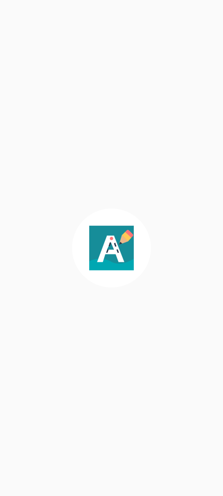
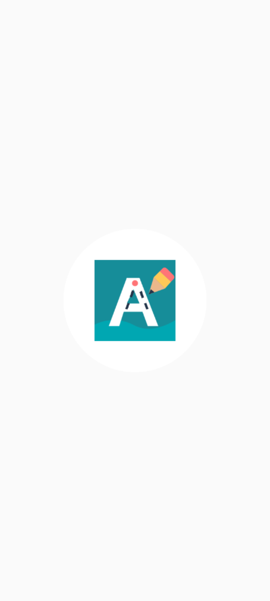
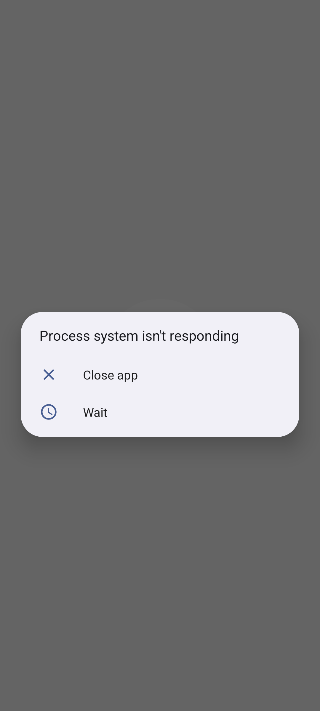

<div align="center">


# SLOVIGO
### Učimo pisati kroz igru

**Vesela Android učionica u kojoj svako slovo postaje mala pustolovina.**

[](https://developer.android.com/)
[](https://developer.android.com/jetpack/compose)
[](#privatnost-i-sigurnost)
[](https://github.com/bren-wp/Slovigo/releases)
[](https://github.com/bren-wp/Slovigo/actions/workflows/android.yml)

**[Preuzmi testnu verziju](https://github.com/bren-wp/Slovigo/releases)** · **[Pregledaj izvorni kod](https://github.com/bren-wp/Slovigo)** · **[Privatnost](PRIVACY.md)**

</div>

---

## ✨ Učenje koje izgleda kao igra

**SLOVIGO** je hrvatska nativna Android aplikacija za vježbanje pravilnog pisanja velikih i malih tiskanih slova. Dijete prati označene poteze prstom, uči redoslijed crtanja i vidi vlastiti napredak — bez oglasa i bez korisničkog računa.

| 🔤 Hrvatska abeceda | ✍️ Pisanje prstom | ⭐ Pohvale i napredak |
|:--:|:--:|:--:|
| Svih 30 slova, uključujući Č, Ć, Đ, Š, Ž, DŽ, LJ i NJ | Smjerovi i početne točke poteza | Lokalno praćenje naučenih slova |

## 📱 Kako aplikacija stvarno izgleda

Ovdje se prikazuju **prave snimke zaslona iz pokrenutog Android emulatora**, a ne ranije izrađene promotivne ilustracije.

<div align="center">
  
  
</div>

**Responzivni vodoravni prikaz (stvarna snimka emulatora):**

<div align="center">
  
</div>

Snimku automatski izrađuje [GitHub Actions — Capture actual Android screenshots](https://github.com/bren-wp/Slovigo/actions/workflows/screenshots.yml). Ako slika nije još dostupna, snimanje emulatora nije završeno. Svaki novi zaslon dodavat će se u galeriju **tek nakon stvarnog snimanja iz aplikacije**.

> **Status dizajna:** zaslon **01 — Splash** posebno je izrađen prema dostavljenoj vizualnoj referenci. Preciznost 1:1 nije izmjerena niti potvrđena automatiziranom usporedbom snimki. Ostali zasloni postoje kao funkcionalna početna verzija i redom će dobiti svoju vizualnu doradu.

## 🎨 Vizualni identitet

| Boja | HEX | Namjena |
|:--|:--|:--|
| 🟦 Tirkizna | `#168D99` | Primarne akcije i napredak |
| 🟨 Žuta | `#FFC857` | Aktivni potezi, poticaji |
| 🟥 Koraljna | `#FF7477` | Istaknuti detalji i maskota |
| 🟪 Plava | `#6C84E8` | Obrazovne kartice |
| ⬜ Krem | `#FFF9EF` | Pozadine i prostor za pisanje |
| ⬛ Tamnoplava | `#243449` | Naslovi i čitljiv tekst |

Ilustracije osnovnog zaslona implementirane su kao **Compose vektorski crteži** kako bi bile oštre na ekranima različitih gustoća. Ne koriste vanjske CDN-ove, mrežno učitavanje ili ugrađene slike cijelog zaslona.

## 🧩 Zasloni i razvojni redoslijed

| # | Zaslon | Stanje |
|--:|:--|:--|
| 01 | Splash / Dobrodošlica | ✅ Zaseban responzivni dizajn |
| 02 | Početni izbornik | Funkcionalan, vizualna dorada sljedeća |
| 03 | Velika tiskana slova | Funkcionalan, vizualna dorada slijedi |
| 04 | Mala tiskana slova | Funkcionalan, vizualna dorada slijedi |
| 05 | Vođeno pisanje | Funkcionalan, potrebna pedagoška provjera putanja |
| 06 | Uspješno završena vježba | Funkcionalan, vizualna dorada slijedi |
| 07 | Napredak | Funkcionalan, vizualna dorada slijedi |
| 08 | Igre | Osnovna igra, za proširenje |
| 09 | Postavke | Osnovne funkcije, vizualna dorada slijedi |

## 🛠️ Tehnologija i uređaji

- **Kotlin + Jetpack Compose + Material 3**
- **Gradle 9.6 / AGP 9.4.1 / JDK 17**, AndroidX Compose BOM 2026.09.00
- **compileSdk 37**, **targetSdk 36**, **minSdk 24**
- Android 7.0+; mobiteli, veliki telefoni, tableti i vodoravni prikaz
- Komponente su u `dp/sp`; na širokim zaslonima Splash koristi **dva stupca**
- Lokalne postavke i spremanje napretka; izgovor slova preko sustavne TTS usluge

## 🚀 Pokretanje i izdanja

Preuzmi **APK** iz odjeljka [Releases](https://github.com/bren-wp/Slovigo/releases). **Debug APK** namijenjen je testiranju i instalaciji izvan Trgovine Play. Ako izdanje sadrži `UNSIGNED.aab`, taj Android App Bundle **nije spreman za Google Play**.

Za razvoj otvori projekt u Android Studiju s JDK 17 i instaliranim Android SDK 37.0. CLI build:

```bash
gradle :app:testDebugUnitTest :app:lintDebug :app:assembleDebug :app:assembleRelease :app:bundleRelease
```

Automatsko izdanje generira se nakon uspješnog builda na `main`. Za stvarno potpisane release APK/AAB pakete spremi sljedeće tajne u **GitHub Actions Secrets**, bez objavljivanja privatnog ključa:

`SLOVIGO_KEYSTORE_BASE64`, `SLOVIGO_STORE_PASSWORD`, `SLOVIGO_KEY_ALIAS`, `SLOVIGO_KEY_PASSWORD`.

## 🔐 Privatnost i sigurnost

SLOVIGO ne traži račun, ne prikazuje oglase, nema pristup internetu i ne koristi analitiku. Podaci o napretku spremaju se **lokalno** i ne uključuju se u Android backup. Ako je uključen zvuk, Android TextToSpeech koristi sustavnog pružatelja, čija vlastita obrada ovisi o njegovim pravilima.

> Usklađenost s Google Play pravilima za dječje aplikacije nije automatski potvrđena uspješnom kompilacijom. Prije objave potrebno je pregledati sadržaj, pristupačnost, izjave Data Safety i Families pravila te konfigurirati potpisivanje.

## 📋 Licenca, kvaliteta i doprinosi

[Izvorni kod](https://github.com/bren-wp/Slovigo) · [Automatizirani testovi](https://github.com/bren-wp/Slovigo/actions/workflows/android.yml) · [Politika privatnosti](PRIVACY.md) · [Licenca](LICENSE)

Dizajnerske reference su smjernice, a **stvarne snimke aplikacije** izrađuju se automatizirano. Pritom se ne predstavljaju koncepti kao gotovi proizvodi.
